# NeuroWatch

> **A calm, longitudinal space for behavioral and cognitive health check-ins.**  
> NeuroWatch captures subtle daily digital biomarkers—typing cadence, reaction timing, memory recall, and speech articulation—and translates them into a gentle, longitudinal dashboard built for comfort, clarity, and doctor-ready communication.

---

## What is NeuroWatch?

Traditional neurological check-ins and cognitive assessments can feel clinical, intimidating, and stressful. High test anxiety can artificially distort a patient’s true cognitive baseline. 

**NeuroWatch** rethinks cognitive tracking from a **patient-first, calm-computing perspective**:

- **Gentle Patient Experience**: Slow pacing, supportive language, and reduced visual clutter reduce test-induced anxiety.
- **Continuous Behavioral Awareness**: Rather than an abrupt one-off evaluation, NeuroWatch tracks subtle motor and cognitive patterns over weeks and months.
- **Non-Diagnostic, Objective Signals**: Designed as an early behavioral awareness tool—not a diagnostic label. It identifies subtle deviations and trends to empower informed doctor consultations.
- **Doctor-Ready Reports**: Generates structured clinical summaries and downloadable PDF reports that patients can bring to their healthcare providers.

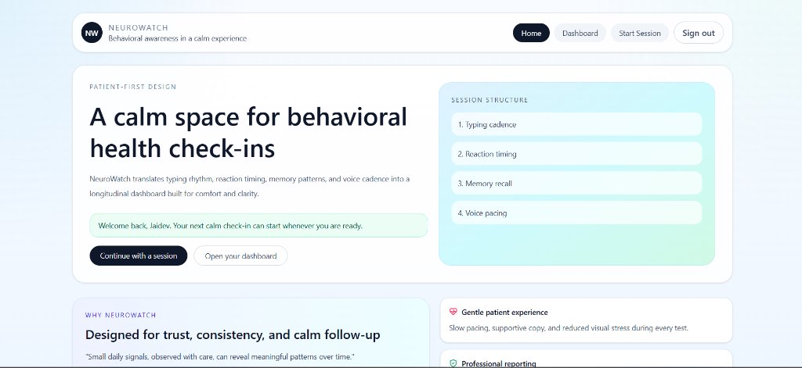

---

## Guided Session Flow: The 4 Behavioral Domains

Each NeuroWatch session takes approximately **3 to 5 minutes** and guides the user through four structured cognitive and motor tasks.

```
┌─────────────────┐      ┌─────────────────┐      ┌─────────────────┐      ┌─────────────────┐      ┌─────────────────┐
│   Step 0: Calm  │ ──►  │ Step 1: Typing  │ ──►  │ Step 2: Reaction│ ──►  │  Step 3: Memory │ ──►  │  Step 4: Voice  │
│ 4-7-8 Breathing │      │ Motor Rhythm    │      │ Visual Orb Attn │      │ Recall & Pattern│      │ Speech Cadence  │
└─────────────────┘      └─────────────────┘      └─────────────────┘      └─────────────────┘      └─────────────────┘
```

### 0. Pre-Session Grounding (4-7-8 Breathing Cycle)
Before any measurement begins, NeuroWatch helps the user settle in with an interactive breathing cycle: **4s inhale, 7s hold, 8s slow exhale**. This normalizes baseline heart rate and mental stress, ensuring data reflects natural cognitive status rather than situational anxiety.

<p align="center">
  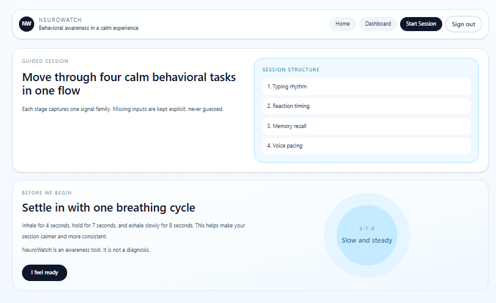
</p>

---

### Step 1: Typing Dynamics (Motor Coordination & Rhythm)
Patients copy a natural reading passage at their own comfortable pace. Key events are analyzed at millisecond precision to evaluate fine motor stability:

- **Words Per Minute (WPM)**: Typing cadence and baseline motor velocity.
- **Keystroke Interval Variance (ms)**: Rhythm steadiness between consecutive keystrokes.
- **Key-Hold Duration (ms)**: Dwell time on individual keys (measures motor hesitation or muscle rigidity).
- **Backspace Frequency**: Correction rate reflecting error pressure and cognitive self-monitoring.
- **Accuracy & Error Rate (%)**: Motor coordination and character mismatch detection.

<p align="center">
  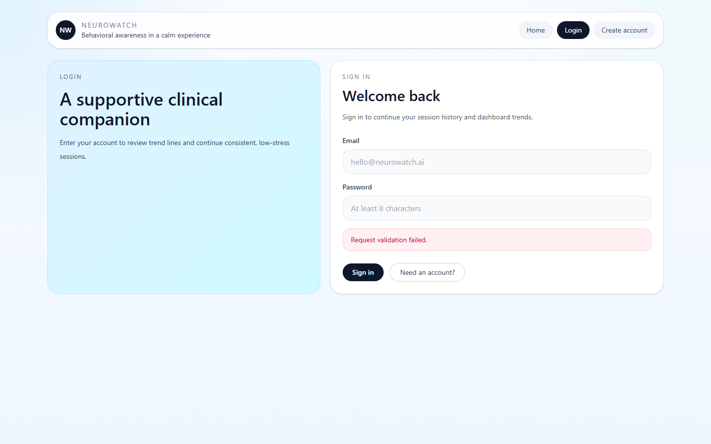
</p>

---

### Step 2: Reaction Timing (Processing Speed & Sustained Attention)
Users observe a calm visual orb that glows after randomized time intervals across 12 trials:

- **Mean Response Latency (ms)**: Processing speed and sensory-motor reaction latency.
- **Attentional Variance**: Stability of response speed across sequential trials.
- **Anticipation Errors**: Premature tapping prior to the stimulus, revealing impulse control and motor restlessness.
- **Attentional Slips & Misses**: Failure to react within the stimulus window (1200ms).

<p align="center">
  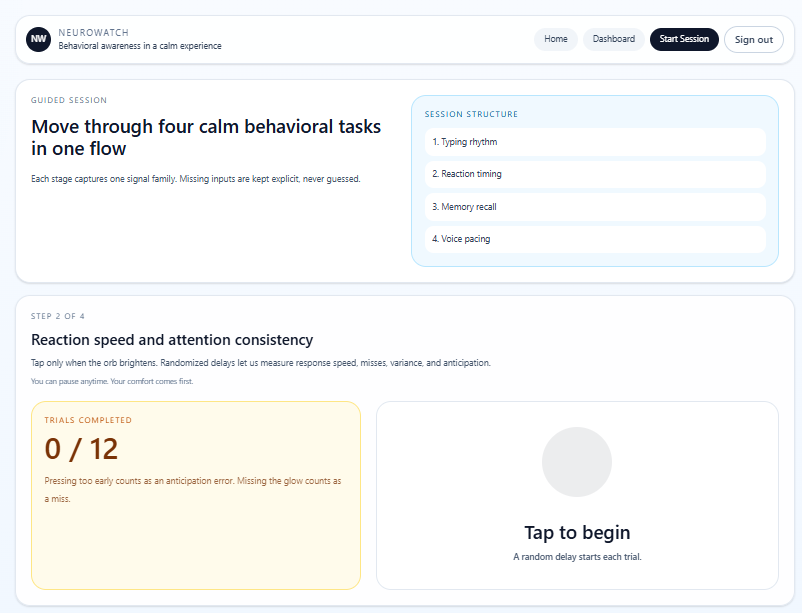
</p>

---

### Step 3: Memory Performance (Recall, Recognition, and Working Memory)
A progressive cognitive snapshot testing three complementary facets of memory:

1. **Immediate Word Recall**: Patients study a target word set, and later perform free recall without cues.
2. **Pattern & Sequence Recognition**: Multi-choice discrimination against distractor words, including chronological order questions (*"Which word appeared first?"*, *"Which word was third?"*).
3. **Digit Span Retention**: Memorizing and reproducing number sequences to evaluate working memory capacity.

| Verbal Acquisition | Pattern & Order Recall | Sequence Memory |
|:---:|:---:|:---:|
| 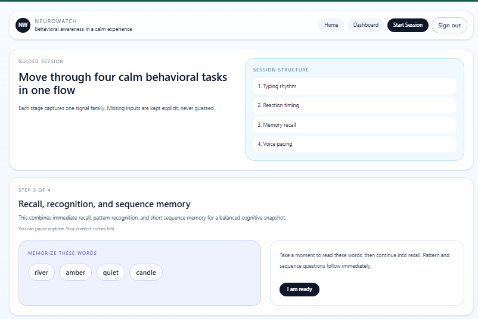 | 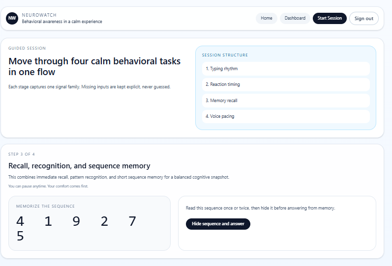 | 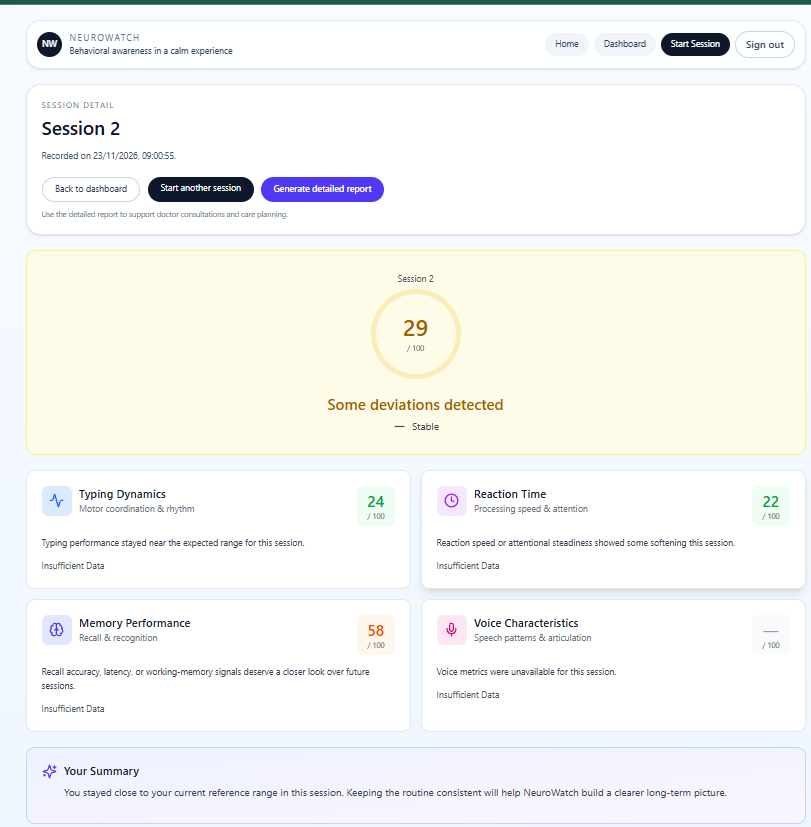 |

---

### Step 4: Voice Characteristics (Speech Cadence & Articulation)
Patients read a calm standard passage aloud. Audio is analyzed for linguistic and acoustic signals:

- **Speech Cadence & Pace**: Syllables per second and natural phrasing tempo.
- **Pause Duration & Hesitations**: Silent gaps between sentences and micro-pauses.
- **Articulation & Vocal Clarity**: Phonation consistency and speech stability.
- **Transparent Fallback**: Voice recording can be skipped at any time. Missing microphone inputs are handled explicitly without guessing or penalizing other scores.

<p align="center">
  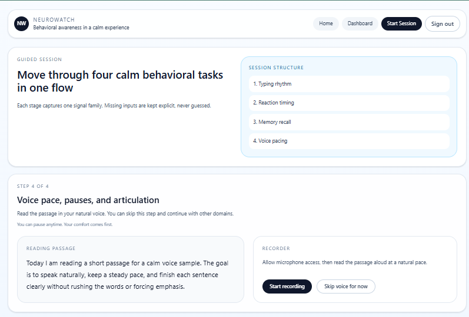
</p>

---

## Longitudinal Dashboard & Clinical Insights

Upon completing a session, NeuroWatch evaluates measurements against the user's **personal rolling baseline** to produce a multi-tiered report.

### 1. Multi-Domain Dashboard
A holistic overview breaking down composite cognitive and motor health:
- **Composite Behavioral Awareness Score (0–100)**: Transparent risk categorization:
  - `0 – 25`: **Within normal range** (Stable)
  - `26 – 50`: **Some deviations detected** (Mild fluctuation)
  - `51 – 70`: **Notable behavioral change** (Elevated monitoring)
  - `71 – 100`: **Higher monitoring concern** (Requires attention)
- **Domain Scorecards**: Individual metrics for Typing, Reaction, Memory, and Voice with direction-of-change badges.

<p align="center">
  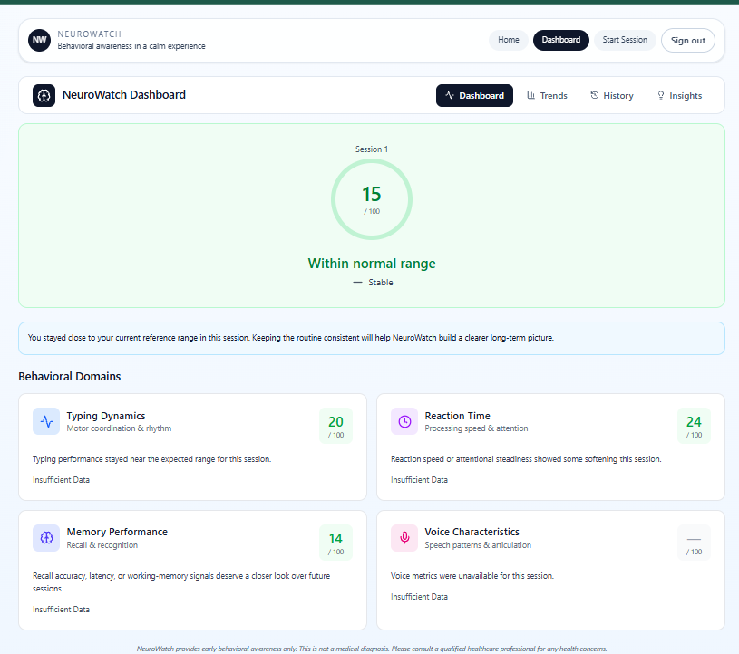
</p>

---

### 2. Personalized Insights & Wellness Suggestions
The **Insights** tab highlights qualitative findings and constructive next steps:
- **Your Summary**: Calm, contextual explanation of how today's session compared to baseline.
- **What's Going Well**: Identifies domains that remained robust and stable.
- **Wellness Suggestions**: Evidence-backed recommendations (consistent sleep/wake times, hydration, mental stimulation).
- **Next Session Focus**: Notifies users which specific domain showed the highest deviation today.

<p align="center">
  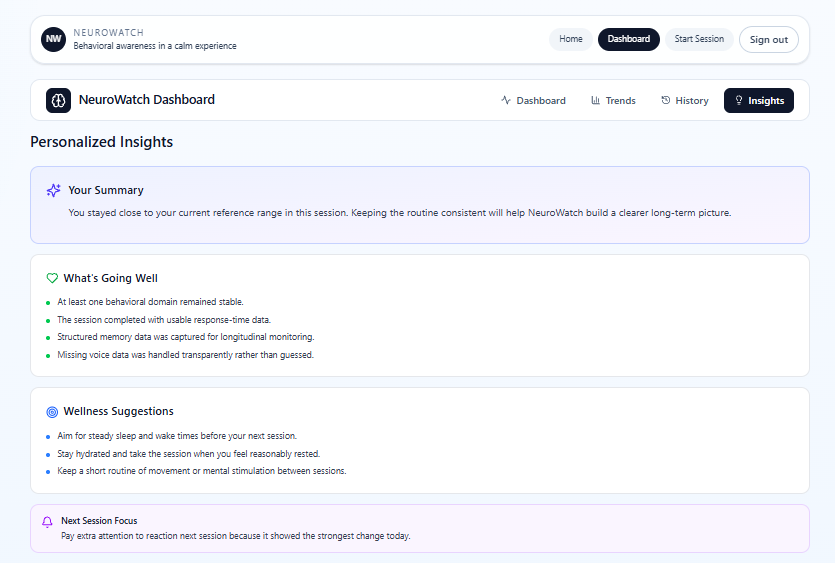
</p>

---

### 3. Progress Analysis & Historical Trends
Tracking single data points can be misleading; long-term trajectory is what matters:
- **Progress Over Time**: Interactive trend charts comparing every session against rolling baselines.
- **Session History Log**: Historical ledger of all recorded sessions with timestamps, status tags, and drill-down links.

| Progress Trend Analysis | Historical Session Log |
|:---:|:---:|
| 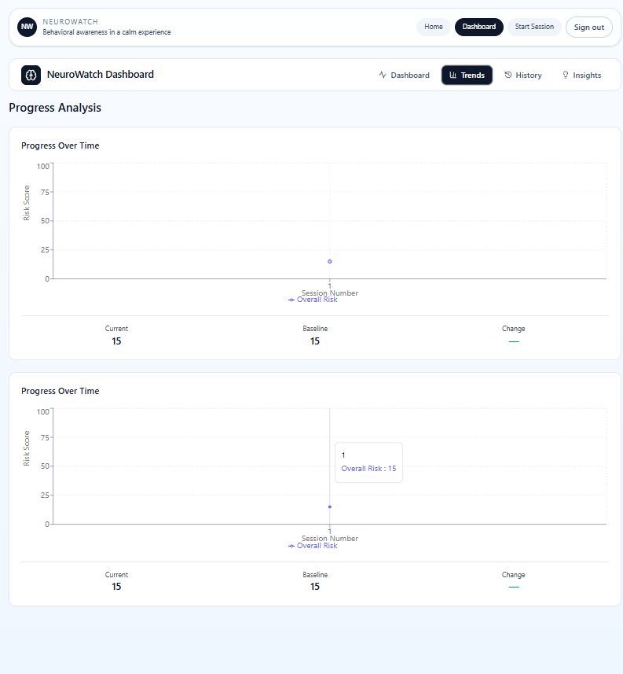 | 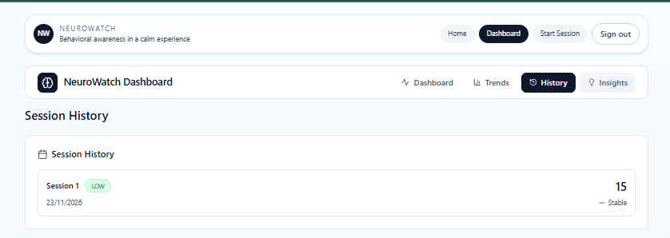 |

---

### 4. Doctor-Ready PDF Reporting
Patients can click **"Generate detailed report"** on any session to produce a clean, formatted clinical summary suitable for consultations with neurologists, primary care physicians, or therapists.

<p align="center">
  
</p>

---

## Technical Architecture

```
┌──────────────────────────────────────────────┐
│             Frontend (Vite + React)          │
│ Tailwind CSS v4 • Radix UI • Lucide • MUI    │
└──────────────────────┬───────────────────────┘
                       │ JSON API / Cookie Auth
┌──────────────────────▼───────────────────────┐
│             Backend (FastAPI)                │
│  - Secure httpOnly JWT Cookie Authentication  │
│  - Dual Analysis Engine:                     │
│      • Local Deterministic Rules Engine      │
│      • Optional OpenAI Whisper & GPT Engine  │
│  - SlowAPI Rate Limiting & Error Handlers     │
└──────────────────────┬───────────────────────┘
                       │ SQLAlchemy ORM & Alembic
┌──────────────────────▼───────────────────────┐
│                 Database                     │
│  - SQLite (Zero-friction local dev)          │
│  - PostgreSQL / Neon (Production scalable)   │
└──────────────────────────────────────────────┘
```

---

## Getting Started

### Prerequisites
- **Node.js**: `18.0+`
- **Python**: `3.11+`

### 1. Environment Configuration

Copy [.env.example](.env.example) to `.env`:

```bash
cp .env.example .env
```

Generate a secure JWT secret:
```bash
python -c "import secrets; print(secrets.token_urlsafe(48))"
```

Configure `.env`:
```ini
DATABASE_URL=sqlite+pysqlite:///./backend/data/neurowatch.db
JWT_SECRET=your-generated-secret-here
JWT_ISSUER=neurowatch
JWT_TTL_SECONDS=2592000
CORS_ORIGINS=http://localhost:5173
AUTH_PROVIDER=local
# Optional: add OPENAI_API_KEY for Whisper voice transcription
OPENAI_API_KEY=
```

### 2. Install Dependencies

**Frontend**:
```bash
cd frontend
npm install
cd ..
```

**Backend**:
```bash
# Recommended: Create virtual environment
python -m venv venv
# On Windows: .\venv\Scripts\activate
# On Linux/macOS: source venv/bin/activate

pip install -r backend/requirements.txt
```

### 3. Run Database Migrations

```bash
cd backend
alembic upgrade head
cd ..
```

### 4. Start the Application

Run both frontend and backend concurrently:
```bash
npm run dev
```

Or run each in dedicated terminals:
- **Backend API**: `python -m uvicorn app.main:app --reload --port 8000 --app-dir backend`
- **Frontend SPA**: `npm --prefix frontend run dev`

Open your browser:
- **Web App**: [http://localhost:5173](http://localhost:5173)
- **Interactive API Docs**: [http://localhost:8000/docs](http://localhost:8000/docs)
- **Backend Health**: [http://localhost:8000/api/v1/health](http://localhost:8000/api/v1/health)

### Firebase Authentication Setup (Optional)

NeuroWatch supports local cookie authentication by default, with an optional Firebase auth provider seam:

1. Install Firebase in the frontend:
   ```bash
   npm --prefix frontend install firebase
   ```
2. Configure Firebase in `.env`:
   - Set `VITE_AUTH_PROVIDER=firebase`
   - Add frontend web config keys (`VITE_FIREBASE_API_KEY`, `VITE_FIREBASE_PROJECT_ID`, etc.)
   - Set `FIREBASE_SERVICE_ACCOUNT_JSON` (or `FIREBASE_PROJECT_ID` + `FIREBASE_CLIENT_EMAIL` + `FIREBASE_PRIVATE_KEY`) so the backend can verify Firebase ID tokens.
3. **Authentication Flow**:
   - The frontend signs in users with the Firebase SDK.
   - The frontend sends the Firebase `id_token` to `POST /api/v1/auth/firebase`.
   - The backend verifies the token and issues a secure `httpOnly` session cookie.
   - Protected routes continue using standard cookie authentication middleware seamlessly.

---

## Production Build & Deployment

### Local Production Build

```bash
npm run build:frontend
python -m uvicorn app.main:app --port 8000 --app-dir backend
```
FastAPI will automatically serve the built SPA from `frontend/dist/` when present.

### Deployment — AWS Lightsail (Ubuntu)

This project is configured for deployment to a single AWS Lightsail Ubuntu instance using **nginx + systemd + gunicorn + uvicorn** (no Docker overhead). On every push to `main`, GitHub Actions runs tests + frontend build, then connects via SSH into the Lightsail server to run the release pipeline.

#### Deployment Script Inventory:

- [`deploy/lightsail/bootstrap.sh`](deploy/lightsail/bootstrap.sh) — One-time server provisioning (nginx, Python, Node 20, certbot, ufw firewall, fail2ban)
- [`deploy/lightsail/deploy.sh`](deploy/lightsail/deploy.sh) — Application release script: installs dependencies, builds frontend, executes database migrations, and reloads the service
- [`deploy/lightsail/deploy-production.sh`](deploy/lightsail/deploy-production.sh) — One-command git pull + automated release (executed by CI/CD)
- [`deploy/lightsail/rollback.sh`](deploy/lightsail/rollback.sh) — Instant rollback to the previous successful release
- [`deploy/lightsail/enable-ssl.sh`](deploy/lightsail/enable-ssl.sh) — Automated Let's Encrypt TLS certificate provisioning
- [`deploy/lightsail/neurowatch.service`](deploy/lightsail/neurowatch.service) — Systemd unit managing `gunicorn` with asynchronous `uvicorn` workers
- [`deploy/lightsail/nginx.neurowatch.conf`](deploy/lightsail/nginx.neurowatch.conf) — Nginx reverse proxy configuration (ports 80/443 → `127.0.0.1:8000`)
- [`.github/workflows/deploy-lightsail.yml`](.github/workflows/deploy-lightsail.yml) — Automated CI/CD pipeline via GitHub Actions over SSH

> For full, step-by-step instructions, see the [Lightsail Deployment Guide](docs/lightsail-deployment.md).

---

## Testing & Quality Assurance

Run the test suite:
```bash
python -m pytest
```

The test suite covers:
- **Integration**: Auth flow (Signup, Login, Cookie lifecycle, Firebase token exchange seam), session submission, and retrieval.
- **Unit**: Baseline calculations, metric derivations (typing, reaction, memory, voice), fallback heuristics, and reporting engines.

---

## Clinical Disclaimer

> [!IMPORTANT]
> **NeuroWatch is an early behavioral awareness and digital tracking tool. It does not provide medical diagnoses, clinical staging, or treatment recommendations.**  
> Cognitive and motor metrics can be influenced by normal daily factors including sleep quality, fatigue, caffeine intake, mood, and stress. If you or a loved one have concerns regarding cognitive or neurological health, please consult a qualified healthcare professional.
